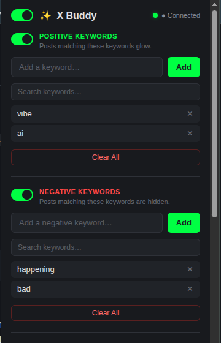
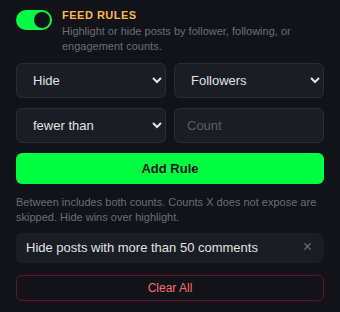
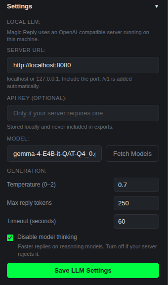
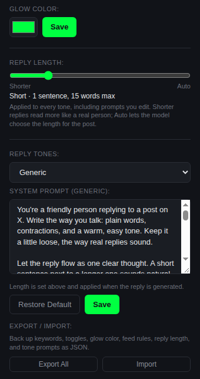

<p align="center">
  
</p>

<h1 align="center">X Buddy</h1>

<p align="center">Keyword highlights, count-based feed rules, negative filtering, and AI reply drafts for X, powered by a model running on your own machine.</p>

> **X Buddy is under active development.** It works, but it is rough around the edges and X changes their site a lot. Expect a broken selector now and then. If something stops working, open an issue and include what you see.

<p align="center">
  
</p>

<p align="center"><em>The popup, with positive and negative keyword lists.</em></p>

## What it does

- **Keyword glow.** Add words you care about and matching posts in your timeline glow in the color you pick (green by default). Useful when you want to spot a topic without reading every post.
- **Negative keywords.** Add words you never want to see and matching posts are hidden from the timeline. Turn the whole list off whenever you want it back.
- **Feed rules.** Highlight or hide posts by the author's follower count, or by a post's comments, likes, or reposts. For example, hide posts from accounts with fewer than 1,000 followers, or highlight posts with more than 100 comments.
- **Toggles.** A master switch pauses everything without losing your settings, and separate switches control positive highlighting, negative filtering, and feed rules.
- **List controls.** Search either list, page through long lists, and clear a list in one click. Duplicate and over-long keywords are rejected with feedback.
- **Glow color.** Pick any highlight color in Settings instead of the default green.
- **Backup.** Export keywords, toggles, glow color, feed rules, reply length, tone prompts, and LLM settings to a JSON file, and import them on another browser.
- **Right-click capture.** Select a word or hashtag on X and add it to either list from the context menu, with a toast confirming the add.
- **Magic Reply with tones.** Open a reply, pick a tone (Generic, Agree, Disagree, Funny, or Informative), and your local model writes a draft straight into the composer. Each tone has its own editable prompt and a Reply Length slider keeps drafts short or lets them run longer. You can edit the draft before posting.
- **Local LLM settings.** Point Magic Reply at any OpenAI-compatible server on `localhost` or `127.0.0.1`, choose the model, and tune temperature, max reply tokens, timeout, and thinking. An optional API key is supported.
- **Stays local.** No accounts and no tracking. Most local servers need no API key; if yours does, it stays in Chrome's local storage. Your keywords and posts go to the model on your computer and nowhere else.

## What you need

- Chrome 111 or newer (tested on Chrome 156)
- A local OpenAI-compatible server. The default is `http://localhost:8080`, but you can set the URL and port in **Settings → Local LLM**.
- A model the server can load. The extension defaults to `gemma-4-E4B-it-QAT-Q4_0.gguf` and is tuned around it, but other chat models should work. Choose the model in Settings.

The model is not bundled. You need to run the server yourself.

### Starting a server

With llama.cpp:

```bash
llama-server -m path/to/gemma-4-E4B-it-QAT-Q4_0.gguf --port 8080
```

With LM Studio, start the local server and load the model there. Use the port LM Studio shows (usually `1234`) as the Server URL.

With Ollama, run `ollama serve` and use `http://localhost:11434` as the Server URL.

The server must be on `localhost` or `127.0.0.1`. Remote and LAN endpoints are not supported yet.

## Install

X Buddy is not on the Chrome Web Store yet, so you load it unpacked.

1. Open `chrome://extensions`
2. Turn on **Developer mode** in the top right
3. Click **Load unpacked**
4. Pick the `x-buddy` folder
5. Open `https://x.com`

Pin the extension to your toolbar so the popup is easy to reach.

## Use it

### Highlight keywords

1. Click the X Buddy icon
2. Type a keyword and press **Add**
3. Matching posts glow in your chosen color as you scroll

Posts already on the page update too, so you do not need to reload.

### Hide posts you do not want

1. Click the X Buddy icon
2. Under **Negative Keywords**, type a word and press **Add**
3. Posts matching that word disappear from the timeline

The helper text under the section says it plainly: **Posts matching these keywords are hidden.** Negative filtering is on by default; an empty list hides nothing. Remove the word, or flip the negative toggle off, and the posts come back.

Both lists match whole words, case-insensitively, so `ai` will not match `rain`. Hashtag and punctuation keywords such as `#AI` and `C++` work too. Negative matching looks at the post body, not the author's name or handle.

Each list has its own search box, five-item pages, and a **Clear All** button. Search is case-insensitive, Clear All asks before deleting, keywords are capped at 100 characters, and duplicates are rejected regardless of case.

### Highlight or hide posts by counts

1. Click the X Buddy icon
2. Under **Feed Rules**, choose **Hide** or **Highlight**
3. Pick a count: **Followers**, **Comments**, **Likes**, or **Reposts**
4. Choose **fewer than** or **more than** and type a number
5. Click **Add Rule**

Rules apply as you scroll and to posts already on the page. Add up to 20. A hide rule wins over a highlight rule, and rules are independent of the keyword lists: the Feed Rules toggle and the master toggle turn them off without deleting them.

Comments are the replies X shows under a post. Comparisons are strict: `fewer than 1,000` does not match exactly 1,000. Thresholds compare the count X has loaded for the post; the rounded number shown on the post is only a fallback. Reposts are judged by the account whose post is shown (the original author), and image-only posts are still checked.

X does not display follower counts on posts in the timeline, so the extension reads the count from the post data X already loaded on the page. If X does not expose a count for a post, that rule leaves the post alone. Comments, likes, and reposts fall back to the counts visible on the page if the post data is unavailable.

<p align="center">
  
</p>

<p align="center"><em>Feed Rules: choose an action, a metric, a comparison, and a count.</em></p>

### Pause everything

The toggle next to the X Buddy title is the master switch. Turning it off removes highlighting, hidden posts, and Magic Reply buttons without deleting any settings. Turn it back on to restore them.

### Pick a glow color

1. Click the X Buddy icon
2. Expand **Settings**
3. Choose a color, then click **Save**

Matching posts use the new color immediately, and the choice survives reloads.

### Back up your settings

1. Click the X Buddy icon and expand **Settings**
2. Click **Export All** to download `xbuddy-config.json`
3. On another browser, click **Import** and pick that file

A full config restore replaces the current keyword lists, toggles, glow color, feed rules, reply length, tone prompts, and non-secret LLM settings (server URL, model, and generation options). The API key is never included in exports or imports. Older files that contain only `positive` and/or `negative` arrays are merged into the current lists instead of replacing them.

### Add a keyword from the page

1. Select a word or phrase on X
2. Right-click and choose **Add "..." to Positive Keywords** or **Add "..." to Negative Keywords**
3. A toast confirms the add, and the popup list updates

Right-clicking a hashtag selects it for you. A leading `#` is stripped, so adding `#AI` stores `AI` and matches both hashtag and plain mentions. If the word is already in that list, a toast says so instead of adding it twice.

### Configure your local LLM

1. Click the X Buddy icon and expand **Settings**
2. Under **Local LLM**, enter the **Server URL** (for example `http://localhost:8080` or `http://localhost:11434`)
3. Click **Fetch Models** and choose a model, or type the model name yourself
4. Add an **API Key** only if your server requires one
5. Adjust **Temperature**, **Max reply tokens**, **Timeout**, and **Disable model thinking** as needed
6. Click **Save LLM Settings**

The status dot next to the title shows whether the saved server is reachable. Magic Reply uses the saved settings immediately; you do not need to reload the extension or x.com.

The Server URL must be `localhost` or `127.0.0.1`. Include the port; the extension adds `/v1` for you. If your server does not expose `/v1/models`, **Fetch Models** will fail, but you can still type the model name and save. The API key is stored in Chrome's local storage and is never included in exports.

<p align="center">
  
</p>

<p align="center"><em>Settings → Local LLM: server, model, and generation options.</em></p>

### Draft a reply

1. Open a post's reply dialog, or open the post detail page
2. Click **✨ Magic Reply** next to the send button
3. Choose a tone: **Generic**, **Agree**, **Disagree**, **Funny**, or **Informative**
4. Wait a moment while your model writes
5. Edit the draft if you want, then post it

The reply goes into the composer, not straight to X. You always get the final say.

### Set reply length

1. Click the X Buddy icon and expand **Settings**
2. Under **Reply Length**, drag the slider between **Shorter** and **Longer**
3. The readout shows the current target, for example `Short · 1 sentence, 15 words max`

The setting applies to every tone, including prompts you edit, and is applied when the reply is generated. Shorter settings produce fewer words and fewer follow-up sentences. It is saved as soon as you release the slider and is included in Export All / Import.

### Edit reply tones

1. Click the X Buddy icon and expand **Settings**
2. Under **Reply Tones**, choose the tone you want to edit
3. Change the system prompt, then click **Save**
4. Click **Restore Default** to put the built-in prompt back

Each tone's prompt is saved separately. The Magic Reply menu uses whatever prompt is saved for the tone you pick. Built-in prompts were rewritten in 1.6.0 to sound like a person replying on X. If you saved the old built-in text without editing it, it now picks up the new prompt automatically; prompts you wrote yourself are kept. Click **Restore Default** to reset any tone.

<p align="center">
  
</p>

<p align="center"><em>Settings: glow color, per-tone reply prompts, and backup controls.</em></p>

## Troubleshooting

| What you see | What to try |
|---|---|
| `Failed — Could not reach LLM server at ...` | Make sure your LLM server is running and **Settings → Local LLM** points at the right URL and port. Then reload the extension in `chrome://extensions` and refresh x.com. |
| `Background unavailable — reload the extension` | The extension was reloaded while the tab stayed open. Refresh x.com. |
| Popup says **Offline** | The server is not reachable at the saved Server URL. Start it, check the URL and port in **Settings → Local LLM**, then reopen the popup. If Magic Reply still works, your server may not expose `/v1/models`, which the status check uses. |
| `Failed — LLM server rejected the API key` | Check the API key in **Settings → Local LLM**, or clear it if your server does not use one. |
| `Failed — LLM endpoint or model not found` | Check the Server URL and model name. Click **Fetch Models** to see what the server offers, or type the model name manually. |
| `Failed — LLM request timed out ...` | Increase **Timeout (seconds)** in **Settings → Local LLM**, or use a smaller model. |
| **Fetch Models** fails | Not every server exposes `/v1/models`. Check the URL, or type the exact model name and click **Save LLM Settings** anyway. |
| No glow | Check that the keyword is in the positive list and the positive toggle is on. Keywords match whole words only, so `ai` will not match `rain`. If the glow is there but hard to see, open **Settings** and pick a brighter color. |
| A post I want to read is hidden | Check the negative list and the negative toggle. A negative keyword wins over a positive glow. Remove the word, or turn negative filtering off, to bring the post back. |
| A negative keyword is not hiding anything | Check that the negative toggle is on. Matching is whole-word, so `crypto` does not match `cryptocurrency`; add the longer form as its own keyword. A post whose text has not fully loaded, or is still collapsed behind **Show more**, may only be evaluated once. |
| A feed rule does nothing | Refresh x.com if you just reloaded the extension — reloading an extension does not update tabs that are already open. Then check the **Feed Rules** toggle and the master toggle. Comparisons are strict, so `fewer than 1,000` does not match exactly 1,000. Posts whose count X does not expose are left alone. A hide rule wins over a highlight rule. |
| Follower rules stopped working | X may have changed how it stores post data. Comments, likes, and reposts can still use the counts visible on the page; follower rules need the post data. Reload the extension and check for an update. |
| Replies are too long or too short | Move **Reply Length** in **Settings → Reply Tones** left or right. It applies to every tone, including custom prompts, and overrides sentence limits written into a prompt. |
| Magic Reply button is missing | X may have switched your account to their new web layout. This version supports the classic layout. See the status below. |
| Tone menu does not open | Reload the extension at `chrome://extensions` and refresh x.com. The menu is injected next to the reply send button on the classic layout. |
| Right-click menu is missing | Reload the extension at `chrome://extensions`. Chrome creates the menus on install and startup, so a fresh reload or browser restart picks them up. |
| Import says **Invalid config file** | Use a file created by **Export All**. Import accepts X Buddy version 1, 2, 3, and 4 configs, or older files with `positive` and/or `negative` arrays. |

## What's new in 1.6.0

- Reply tone prompts were rewritten to sound like a person replying on X: specific, short, and free of AI filler.
- A new **Reply Length** slider in **Settings → Reply Tones** sets how wordy Magic Reply drafts are, from one-liners to longer replies. It applies to every tone and overrides sentence limits inside a saved prompt.
- Reply length is included in Export All / Import.
- No new permissions and no extra network requests.

## Status

X Buddy is an early build. What is done and what is next:

- [x] Keyword highlighting
- [x] Negative keyword filtering
- [x] Feed rules for follower and engagement counts
- [x] Master, positive, negative, and feed-rule toggles
- [x] Keyword search, pagination, and clear-all controls
- [x] Configurable glow color
- [x] Full-config export/import
- [x] Right-click keyword capture
- [x] Magic Reply with a local model
- [x] Five reply tones with editable prompts
- [x] Adjustable reply length
- [x] LLM settings for the server URL, model, and generation options
- [ ] Support X's new web layout
- [ ] Chrome Web Store release

X started testing a new web layout for logged-in users in late 2026. It removes most of the hooks this extension uses, so the classic layout is the supported one for now. If your X looks different and nothing shows up, that is why.

## Privacy

- The extension asks for `storage` so it can remember your keywords, and `contextMenus` so you can right-click text to add it to a list.
- Feed rules read follower, comment, like, and repost counts from the post data X already loaded. They add no permissions and make no extra requests.
- It can talk to `x.com`, `twitter.com`, and the local LLM server you configure (`localhost` or `127.0.0.1` only). That is it.
- Your keyword lists, feed rules, reply length, tone prompts, and LLM settings live in Chrome's local storage. The optional API key is stored there in plain text and is excluded from exports.
- Posts are sent to your own model server. Nothing is sent to us, and there is no analytics or remote code.

## License

MIT. See `LICENSE`.

X Buddy is an unofficial project and is not affiliated with X Corp.
