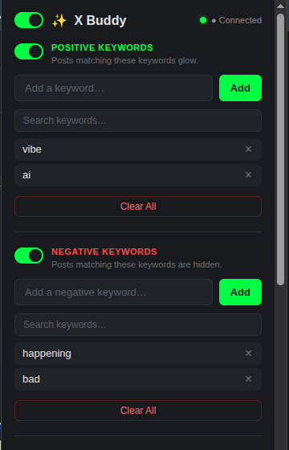
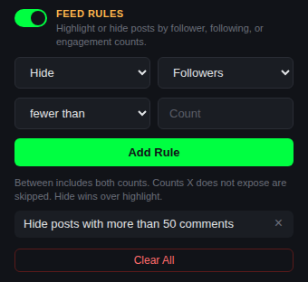
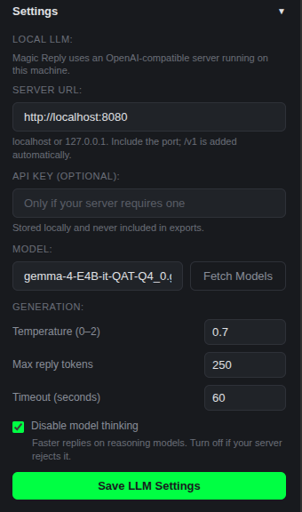
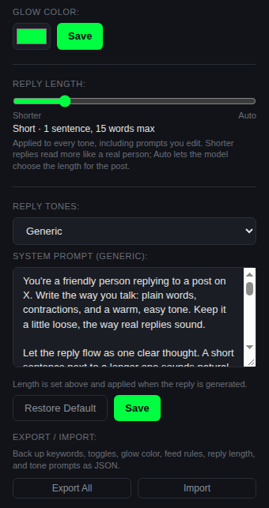

<p align="center">
  
</p>

<h1 align="center">X Buddy</h1>

<p align="center">Keyword highlights, count-based feed rules, negative filtering, and AI reply and post drafts for X, powered by a model running on your own machine.</p>

> **X Buddy is under active development.** It works, but it is rough around the edges and X changes their site a lot. Expect a broken selector now and then. If something stops working, open an issue and include what you see.

<p align="center">
  
</p>

<p align="center"><em>The popup, with positive and negative keyword lists.</em></p>

## What it does

- **Keyword glow.** Add words you care about and matching posts in your timeline glow in the color you pick (green by default). Useful when you want to spot a topic without reading every post.
- **Negative keywords.** Add words you never want to see and matching posts are hidden from the timeline. Turn the whole list off whenever you want it back.
- **Feed rules.** Highlight or hide posts by the author's follower or following count, or by a post's comments, likes, or reposts. Rules can use fewer than, more than, or an inclusive between range. For example, hide posts from accounts with fewer than 1,000 followers, or highlight posts with more than 100 comments.
- **Toggles.** A master switch pauses everything without losing your settings, and separate switches control positive highlighting, negative filtering, and feed rules.
- **List controls.** Search either list, page through long lists, and clear a list in one click. Duplicate and over-long keywords are rejected with feedback.
- **Glow color.** Pick any highlight color in Settings instead of the default green.
- **Backup.** Export keywords, toggles, glow color, feed rules, reply length, writing voice, post examples, tone instructions, and LLM settings to a JSON file, and import them on another browser.
- **Right-click capture.** Select a word or hashtag on X and add it to either list from the context menu, with a toast confirming the add.
- **Writing Voice.** One editable voice is added to every reply and every drafted post. The built-in starter is direct, practical, and conversational: concrete details, honest tradeoffs, no hype, and no AI filler. Edit it to make it yours, restore the default, or import a voice file. Post Examples are used only when drafting an original post.
- **Magic Reply with tones.** Open a reply, pick a tone (Generic, Agree, Connect, Disagree, Funny, or Informative), and your local model writes a draft straight into the composer. Each tone is a short instruction layered on your Writing Voice, and a Reply Length slider keeps drafts short, lets them run longer, or hands the length choice to the model. You can edit the draft before posting.
- **Draft Post.** In the home or profile compose box, or the compose window, type a rough idea and click **✨ Draft Post**. Your model rewrites it into one post in your voice. Edit it, then post; it never posts for you.
- **Local LLM settings.** Point Magic Reply and Draft Post at any OpenAI-compatible server on `localhost` or `127.0.0.1`, choose the model, and tune temperature, max reply tokens, timeout, and thinking. An optional API key is supported.
- **Stays local.** No accounts and no tracking. Most local servers need no API key; if yours does, it stays in Chrome's local storage. Your keywords, posts, and reply notes go to the model on your computer and nowhere else.

## What you need

- Chrome 111 or newer (tested on Chrome 156)
- A local OpenAI-compatible server. The default is `http://localhost:8080`, but you can set the URL and port in **Settings → Local LLM**.
- A model your server can load. X Buddy does not pre-fill a model name: click **Fetch Models** in Settings, or type the exact model name your server exposes.

The model is not bundled. You need to run the server yourself.

### Starting a server

With llama.cpp:

```bash
llama-server -m path/to/your-model.gguf --port 8080
```

With LM Studio, start the local server and load the model there. Use the port LM Studio shows (usually `1234`) as the Server URL.

With Ollama, run `ollama serve` and use `http://localhost:11434` as the Server URL.

The server must be on `localhost` or `127.0.0.1`. Remote and LAN endpoints are not supported yet.

## Install

X Buddy is not on the Chrome Web Store yet, so you load it unpacked.

1. Open `chrome://extensions`
2. Turn on **Developer mode** in the top right
3. Click **Load unpacked**
4. Pick the `x-buddy` folder
5. Open `https://x.com`

Pin the extension to your toolbar so the popup is easy to reach. If the popup shows a **Grant access** banner, click it once and allow access to x.com and twitter.com; Chrome may have withheld site access for the unpacked extension.

### Open tabs stay covered

Chrome only runs the extension's page script when a page loads. If X was already open when Chrome or the extension started, X Buddy now checks the tab, attaches itself, and brings the features back without a refresh. After an extension update it refreshes stale tabs automatically. A tab with an unsent draft is left alone so the draft is not lost; finish or clear the draft, then switch away and back, or refresh when you are ready.

If the popup shows a **Grant access** banner, Chrome has withheld X Buddy's site access. Click **Grant access** and allow x.com and twitter.com. You can also set **Site access** to **On all sites** for X Buddy at `chrome://extensions`; with **On click**, the tab stays inactive until you click the icon and refresh.

## Use it

### Highlight keywords

1. Click the X Buddy icon
2. Type a keyword and press **Add**
3. Matching posts glow in your chosen color as you scroll

Posts already on the page update too, so you do not need to reload.

### Hide posts you do not want

1. Click the X Buddy icon
2. Under **Negative Keywords**, type a word and press **Add**
3. Posts matching that word disappear from the timeline

The helper text under the section says it plainly: **Posts matching these keywords are hidden.** Negative filtering is on by default; an empty list hides nothing. Remove the word, or flip the negative toggle off, and the posts come back.

Both lists match whole words, case-insensitively, so `ai` will not match `rain`. Hashtag and punctuation keywords such as `#AI` and `C++` work too. Negative matching looks at the post body, not the author's name or handle.

Each list has its own search box, five-item pages, and a **Clear All** button. Search is case-insensitive, Clear All asks before deleting, keywords are capped at 100 characters, and duplicates are rejected regardless of case.

### Highlight or hide posts by counts

1. Click the X Buddy icon
2. Under **Feed Rules**, choose **Hide** or **Highlight**
3. Pick a count: **Followers**, **Following**, **Comments**, **Likes**, or **Reposts**
4. Choose **fewer than**, **more than**, or **between**. For **between**, enter a **Minimum** and a **Maximum**.
5. Click **Add Rule**

Rules apply as you scroll and to posts already on the page. Add up to 20. A hide rule wins over a highlight rule, and rules are independent of the keyword lists: the Feed Rules toggle and the master toggle turn them off without deleting them.

Comments are the replies X shows under a post. `fewer than` and `more than` are strict: `fewer than 1,000` does not match exactly 1,000. `between` includes both ends, so `between 1,000 and 5,000` matches both 1,000 and 5,000. Thresholds compare the count X has loaded for the post; the rounded number shown on the post is only a fallback. Reposts are judged by the account whose post is shown (the original author), and image-only posts are still checked.

The extension does not compute a follower/following ratio. To narrow both sides of an account, add a **Followers** range and a **Following** range as separate rules.

X does not display follower or following counts on posts in the timeline, so the extension reads them from the post data X already loaded on the page. If X does not expose a count for a post, that rule leaves the post alone. Comments, likes, and reposts fall back to the counts visible on the page if the post data is unavailable.

<p align="center">
  
</p>

<p align="center"><em>Feed Rules: choose an action, a metric, a comparison, and a count.</em></p>

### Pause everything

The toggle next to the X Buddy title is the master switch. Turning it off removes highlighting, hidden posts, Magic Reply buttons, and Draft Post buttons without deleting any settings. Turn it back on to restore them.

### Pick a glow color

1. Click the X Buddy icon
2. Expand **Settings**
3. Choose a color, then click **Save**

Matching posts use the new color immediately, and the choice survives reloads.

### Back up your settings

1. Click the X Buddy icon and expand **Settings**
2. Click **Export All** to download `xbuddy-config.json`
3. On another browser, click **Import** and pick that file

A full config restore replaces the current keyword lists, toggles, glow color, feed rules, reply length, writing voice, post examples, and tone instructions, and updates the non-secret LLM settings (server URL, model, and generation options). The API key is never included in exports or imports. Older files that contain only `positive` and/or `negative` arrays are merged into the current lists instead of replacing them.

### Add a keyword from the page

1. Select a word or phrase on X
2. Right-click and choose **Add "..." to Positive Keywords** or **Add "..." to Negative Keywords**
3. A toast confirms the add, and the popup list updates

Right-clicking a hashtag selects it for you. A leading `#` is stripped, so adding `#AI` stores `AI` and matches both hashtag and plain mentions. If the word is already in that list, a toast says so instead of adding it twice.

### Configure your local LLM

1. Click the X Buddy icon and expand **Settings**
2. Under **Local LLM**, enter the **Server URL** (for example `http://localhost:8080` or `http://localhost:11434`)
3. Click **Fetch Models** and choose a model (the first one is filled in when the field is empty), or type the model name yourself
4. Add an **API Key** only if your server requires one
5. Adjust **Temperature**, **Max reply tokens**, **Timeout**, and **Disable model thinking** as needed
6. Click **Save LLM Settings**

The status dot next to the title shows whether the saved server and model are ready: **Connected**, **Offline**, or **No model**. Magic Reply and Draft Post use the saved settings immediately; you do not need to reload the extension or x.com.

The Server URL must be `localhost` or `127.0.0.1`. Include the port; the extension adds `/v1` for you. If your server does not expose `/v1/models`, **Fetch Models** will fail, but you can still type the model name and save. The API key is stored in Chrome's local storage and is never included in exports.

<p align="center">
  
</p>

<p align="center"><em>Settings → Local LLM: server, model, and generation options.</em></p>

### Draft a reply

1. Open a post's reply dialog, or open the post detail page
2. Click **✨ Magic Reply** next to the send button
3. Choose a tone: **Generic**, **Agree**, **Connect**, **Disagree**, **Funny**, or **Informative**
4. Wait a moment while your model writes
5. Edit the draft if you want, then post it

The reply goes into the composer, not straight to X. You always get the final say. Replies stay warm and on the poster's side. The one exception is **Disagree**, which offers a friendly counterpoint.

**Connect** is for posts that invite people to connect or ask what you are building. It names the specific project or detail from the post, offers to connect, and asks one short question about that detail, without pitching or making up details about your work. The built-in instruction ends the reply with a question mark and uses plain punctuation. You can edit the draft to add your own project before posting.

### Draft a post

1. Open the compose box on the home timeline or a profile page, or open the compose window
2. Type a rough idea, a topic, or a note about what happened
3. Click **✨ Draft Post** next to the **Post** button
4. Wait a moment while your model rewrites the note into one post in your voice
5. Edit it, then post

Draft Post uses the same local model and the same **Writing Voice** as Magic Reply, plus your **Post Examples** for style. It replaces the text in the composer and never posts for you. It strips labels, surrounding quotes, code fences, and stray Markdown the model sometimes adds. If the result is over 280 characters, X Buddy shows a warning; it never truncates your text, so you can edit it yourself. If the composer is empty, the button says **Add an idea first** and sends no request. It creates one post, not a thread. If the home compose box is collapsed, click into it first so the button can appear.

### Set reply length

1. Click the X Buddy icon and expand **Settings**
2. Under **Reply Length**, drag the slider between **Shorter** and **Auto**
3. The readout shows the current target, for example `Balanced · up to 2 sentences, 25 words max`

The setting applies to replies only, including tone instructions you edit. Draft Post takes its length from your Writing Voice. **Balanced** is the default because the shorter setting leaves no room for Connect or Informative replies. Shorter settings produce fewer words and fewer follow-up sentences. **Auto** is the far-right choice: it skips the fixed word and sentence caps and lets the model choose the length from the post. It is saved as soon as you release the slider and is included in Export All / Import.

### Tune your writing voice

1. Click the X Buddy icon and expand **Settings**
2. Under **Writing Voice**, edit the voice, then click **Save Voice**
3. Click **Restore Default** to put the built-in voice back
4. Click **Import .md** to load a voice file. Frontmatter is removed, and you can review the text before saving

The built-in voice is a starter you can keep or replace. It writes the way a person talks: direct, practical, and conversational, with concrete details and honest tradeoffs. It skips hashtags, engagement bait, corporate jargon, AI filler, motivational sign-offs, and fake profundity. It allows up to two emojis in a post and one in a reply; delete that line if you want fewer. It also names the feeling first on a sad or frustrated post, stays gentle without agreeing with a put-down, and avoids claiming a specific model, setup, or hardware that was not in the post. The voice is added before every tone instruction and before Draft Post, so editing it changes every AI draft, not just one tone.

To make it yours, replace the first lines with who you are and how you write, keep the rules that make the writing sound human, and remove any that do not fit. Paste three to five of your own posts into **Post Examples** so Draft Post has your real rhythm to follow. If you already have a voice guide in Markdown, click **Import .md**. **Restore Default** brings the starter back.

**Post Examples** are used only by Draft Post. Paste a few of your own posts, short ones work best. They are style references, not facts to reuse. Leave the box empty to skip them. **Restore Default** brings back the built-in examples.

### Edit tone instructions

1. Click the X Buddy icon and expand **Settings**
2. Under **Reply Tones**, choose the tone you want to edit
3. Change the tone instruction, then click **Save**
4. Click **Restore Default** to put the built-in instruction back

Each tone's instruction is saved separately and added after your Writing Voice. The Magic Reply menu uses whatever instruction is saved for the tone you pick. Built-in instructions keep the reply on the poster's side; only **Disagree** offers a different view, and it now opens with a plain disagreement instead of softening into agreement. If you saved an old built-in prompt without editing it, it now loads as the short instruction. If the intro was lightly edited but the instruction at the end still matches a built-in, the old intro is dropped so the voice is not added twice. Prompts you wrote yourself are kept. Click **Restore Default** to reset any tone.

<p align="center">
  
</p>

<p align="center"><em>Settings: glow color, tone instructions, and backup controls.</em></p>

## Troubleshooting

| What you see | What to try |
|---|---|
| `Failed — Could not reach LLM server at ...` | Make sure your LLM server is running and **Settings → Local LLM** points at the right URL and port. Then reload the extension in `chrome://extensions` and refresh x.com. |
| `Background unavailable — reload the extension` | The extension was reloaded while the tab stayed open. Refresh x.com. |
| Popup says **Offline** | The server is not reachable at the saved Server URL. Start it, check the URL and port in **Settings → Local LLM**, then reopen the popup. If Magic Reply or Draft Post still works, your server may not expose `/v1/models`, which the status check uses. |
| Popup says **No model** | Open **Settings → Local LLM**, click **Fetch Models** and choose one, or type the model name, then click **Save LLM Settings**. Magic Reply and Draft Post need a model. |
| `Failed — LLM server rejected the API key` | Check the API key in **Settings → Local LLM**, or clear it if your server does not use one. |
| `Failed — LLM endpoint or model not found` | Check the Server URL and model name. Click **Fetch Models** to see what the server offers, or type the model name manually. |
| `Failed — LLM request timed out ...` | Increase **Timeout (seconds)** in **Settings → Local LLM**, or use a smaller model. |
| **Fetch Models** fails | Not every server exposes `/v1/models`. Check the URL, or type the exact model name and click **Save LLM Settings** anyway. |
| No glow | Check that the keyword is in the positive list and the positive toggle is on. Keywords match whole words only, so `ai` will not match `rain`. If the glow is there but hard to see, open **Settings** and pick a brighter color. If X Buddy does nothing at all, check for a **Grant access** banner in the popup and allow site access. |
| X Buddy does nothing on a tab | Open the popup. If it shows **Grant access**, click it and allow x.com and twitter.com. You can also set **Site access** to **On all sites** for X Buddy at `chrome://extensions`; **On click** means the page stays inactive until you click the icon and refresh. |
| A post I want to read is hidden | Check the negative list and the negative toggle. A negative keyword wins over a positive glow. Remove the word, or turn negative filtering off, to bring the post back. |
| A negative keyword is not hiding anything | Check that the negative toggle is on. Matching is whole-word, so `crypto` does not match `cryptocurrency`; add the longer form as its own keyword. A post whose text has not fully loaded, or is still collapsed behind **Show more**, may only be evaluated once. |
| A feed rule does nothing | Check the **Feed Rules** toggle and the master toggle. `fewer than` and `more than` are strict; `between` includes both ends. Posts whose count X does not expose are left alone, and follower and following rules need the post data. A hide rule wins over a highlight rule. X Buddy reattaches to open tabs automatically; if a tab still looks stale after an extension update, refresh it. |
| Follower or following rules stopped working | X may have changed how it stores post data. Comments, likes, and reposts can still use the counts visible on the page; follower and following rules need the post data. Reload the extension and check for an update. |
| Replies are too long or too short | Move **Reply Length** in **Settings** left or right. It applies to replies only, including custom tone instructions, and overrides sentence limits written into an instruction. **Auto** lets the model choose, so pick a fixed level if its choice is off. Draft Post ignores it; adjust **Writing Voice** and **Post Examples** instead. |
| Magic Reply button is missing | X may have switched your account to their new web layout. This version supports the classic layout. See the status below. |
| Draft Post button is missing | Open the home or profile compose box first; the button appears once the editable composer is open. X Buddy reattaches automatically after an extension reload; if it is still missing, refresh x.com. If Magic Reply works but Draft Post does not, the send button may not look like a `Post` button in your layout. |
| Draft Post says **Add an idea first** | Type a rough idea or topic in the composer before clicking the button. An empty composer is not sent to the model. |
| A Writing Voice change did not apply | Click **Save Voice**. The next request uses it; no extension reload is needed. If it still looks unchanged, check the service worker console for a storage error. |
| Draft Post does not sound like my examples | Put a few of your own short posts in **Post Examples**, and keep the **Writing Voice** specific: who you are, how you sound, and the rules you care about. Remove rules that do not fit your writing. Very long voices can be truncated. |
| Replies or drafts sound generic | Edit the first lines of the **Writing Voice** to describe you and your topics, and add a few of your own posts to **Post Examples**. The built-in voice is a starter, not a fixed style. |
| Tone menu does not open | Reload the extension at `chrome://extensions`; open X tabs reattach automatically. If the menu still does not appear, refresh x.com. The menu is injected next to the reply send button on the classic layout. |
| Right-click menu is missing | Reload the extension at `chrome://extensions`. Chrome creates the menus on install and startup, so a fresh reload or browser restart picks them up. |
| Features disappear after an extension update | X Buddy normally refreshes an open X tab to bring the new build in. A tab with an unsent draft is left alone; finish or clear the draft, then switch away and back, or refresh x.com. |
| Import says **Invalid config file** | Use a file created by **Export All**. Import accepts X Buddy version 1, 2, 3, 4, and 5 configs, or older files with `positive` and/or `negative` arrays. |

## What's new in 1.7.4

- **New built-in Writing Voice.** The default is now direct, practical, and conversational: concrete details, honest tradeoffs, no hashtags or engagement bait, no AI filler, and no motivational closers. It applies to every Magic Reply tone and to Draft Post.
- **Refreshed Post Examples.** The built-in examples now show a benchmark result, a tool reaction, a priced tradeoff, and a community question. The old cheerleader examples are gone.
- **Make it yours.** The Writing Voice hint explains that the first lines are your profile and the rest are the rules, so other people can swap in their own style. Saved old defaults upgrade automatically; your own edits are kept.

## Status

X Buddy is an early build. What is done and what is next:

- [x] Keyword highlighting
- [x] Negative keyword filtering
- [x] Feed rules for follower, following, and engagement counts
- [x] Master, positive, negative, and feed-rule toggles
- [x] Keyword search, pagination, and clear-all controls
- [x] Configurable glow color
- [x] Full-config export/import
- [x] Right-click keyword capture
- [x] Magic Reply with a local model
- [x] Editable writing voice and post examples
- [x] Six reply tones with editable instructions
- [x] Draft Post with a local model
- [x] Adjustable reply length
- [x] LLM settings for the server URL, model, and generation options
- [ ] Support X's new web layout
- [ ] Chrome Web Store release

X started testing a new web layout for logged-in users in late 2026. It removes most of the hooks this extension uses, so the classic layout is the supported one for now. If your X looks different and nothing shows up, that is why.

## Privacy

- The extension asks for `storage` so it can remember your keywords, `contextMenus` so you can right-click text to add it to a list, and `scripting` so it can reattach its page script to X tabs that were already open when the extension started or updated. `scripting` is used only on x.com and twitter.com.
- Feed rules read follower, following, comment, like, and repost counts from the post data X already loaded. They add no permissions and make no extra requests.
- It can talk to `x.com`, `twitter.com`, and the local LLM server you configure (`localhost` or `127.0.0.1` only). That is it.
- Your keyword lists, feed rules, reply length, writing voice, post examples, tone instructions, and LLM settings live in Chrome's local storage. The optional API key is stored there in plain text and is excluded from exports. The voice and examples are included in exports.
- Posts, reply notes, and the writing voice are sent to your own model server. Nothing is sent to us, and there is no analytics or remote code.

## License

MIT. See `LICENSE`.

X Buddy is an unofficial project and is not affiliated with X Corp.
